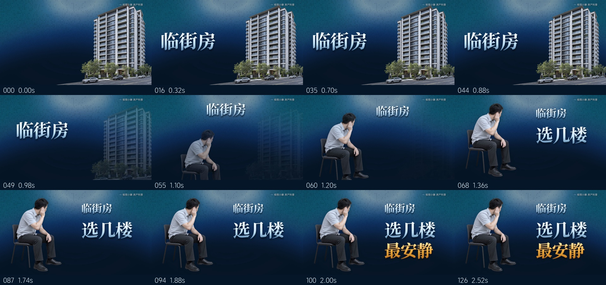
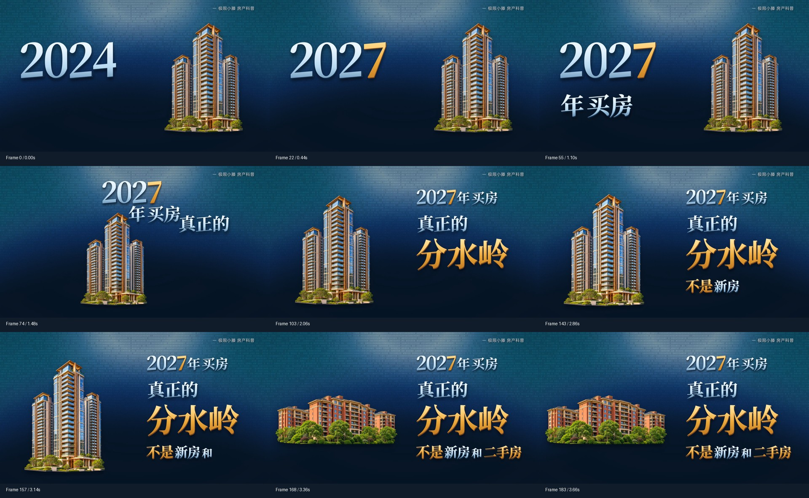

# 小滕片头风格模板

适用于 Codex 的房产口播片头 Skill：蓝青 ASCII 字符背景、透明住宅抠像、冰蓝银色与暖金衬线标题、图文左右连续接力。

附带可编辑的 Remotion 母工程、两张透明住宅示例、三款实际使用字体及授权说明。自动识别 macOS / Windows、芯片、系统版本、Node版本和内存；相同环境复用共享依赖，后续片头继续使用同一母工程。



随包示例的最终MP4关键帧：



## 交给 Codex 安装

复制下面这段给学员的 Codex：

```text
请安装这个 GitHub 仓库中的“小滕片头风格模板”Skill：
https://github.com/pensongchs/xiaoteng-opening-style-template
Skill目录是 skills/xiaoteng-opening-style-template。
安装后在我的工作目录创建片头母工程，自动检查电脑系统、芯片、Node和依赖；
相同环境复用共享运行组，不在每期视频目录重复安装依赖。
请跑通随包示例并检查最终MP4，确认成功后告诉我成片位置。
```

Skill显示名：**小滕片头风格模板**。调用名：`$xiaoteng-opening-style-template`。

## 制作自己的片头

```text
调用小滕片头风格模板Skill。
片头文案：……
时间码字幕：我附上的SRT。
制作范围：……至……。
素材：优先使用我提供的图片；没有合适主体时生成透明抠像。
请复用已有母工程，按真实时间节点制作纯画面片头，交付MP4和关键帧。
```

学员的账号名可以修改。默认1920×1080、50fps、H.264、无音轨；不把口播字幕自动显示在画面中。没有真实时间码时先提供文案规划，不把估计时长说成口播同步。

## 直接运行随包工程

已安装Node的电脑，进入`skills/xiaoteng-opening-style-template/assets/workspace/`，或者让Codex通过`create-project.mjs`创建工作副本后运行：

```text
node scripts/setup.cjs
npm run check
npm run render
npm run verify
```

应生成`renders/示例片头.mp4`，规格为1920×1080、50fps、184帧、3.68秒、H.264、无音轨。示例是“2027年买房，真正的分水岭，不是新房和二手房”，用于验收环境与学习风格。两张住宅为AI生成的类别示意，不对应真实楼盘。

Mac可运行`start.command`，Windows可运行`start.cmd`。缺少Node时启动器显示官方下载入口，不自动更改系统设置。建议由Codex创建工作副本后运行，以便安装目录保持完整。

| 电脑 | 适配方式 |
| --- | --- |
| Apple芯片Mac，macOS 15以上 | 自动使用arm64依赖与浏览器 |
| Intel Mac，macOS 15以上 | 自动使用x64依赖与浏览器 |
| Windows 10/11 64位 | 使用x64 Node和本机编码器，无需管理员目录链接权限 |
| Windows 11 ARM | 识别并提示使用x64 Node兼容环境；原生ARM Node不支持，兼容环境需实机验证 |

## 依赖复用

只在第一次准备缺失资源时下载依赖与浏览器。相同`package.json`、锁文件、npm、Node主版本、操作系统和架构共用运行组；升级依赖或换平台时使用新组。字体已随包提供，网页内加载，无需安装到系统。

共享目录默认在用户主目录下`.codex/shared-node-dependencies/`，设置`CODEX_HOME`时跟随该目录。工程里只放`node_modules`目录链接；Windows使用junction，Mac使用符号链接。不要对链接后的`node_modules`直接执行`npm install`。

固定依赖见[package.json](skills/xiaoteng-opening-style-template/assets/workspace/package.json)和锁文件。背景由准备脚本从React Bits官方固定提交下载并校验，然后在本机适配成Remotion视频时钟；源码与浏览器缓存不随仓库分发。使用条件见[NOTICE.md](NOTICE.md)。

## 复刻验证

仓库已启用[三平台复刻验证](https://github.com/pensongchs/xiaoteng-opening-style-template/actions/workflows/reproduce.yml)：覆盖Apple芯片Mac、Intel Mac和Windows x64，在含中文与空格的新目录中准备环境、重复准备以验证依赖复用、检查代码、完整渲染示例并检查184帧、时长、解码和黑帧。具体结果以对应提交的工作流状态为准。

桌面默认使用ANGLE渲染；CI云端无显卡环境自动使用swangle兼容渲染并发1，保留相同分辨率、帧率和背景着色器。Windows ARM兼容环境未纳入这组验证。媒体检查不替代视觉审看；纯画面示例不包含原声音画同步验证。

详细说明：[运行与复刻](skills/xiaoteng-opening-style-template/references/运行与复刻.md)。风格规则：[DESIGN.md](skills/xiaoteng-opening-style-template/assets/workspace/DESIGN.md)。
